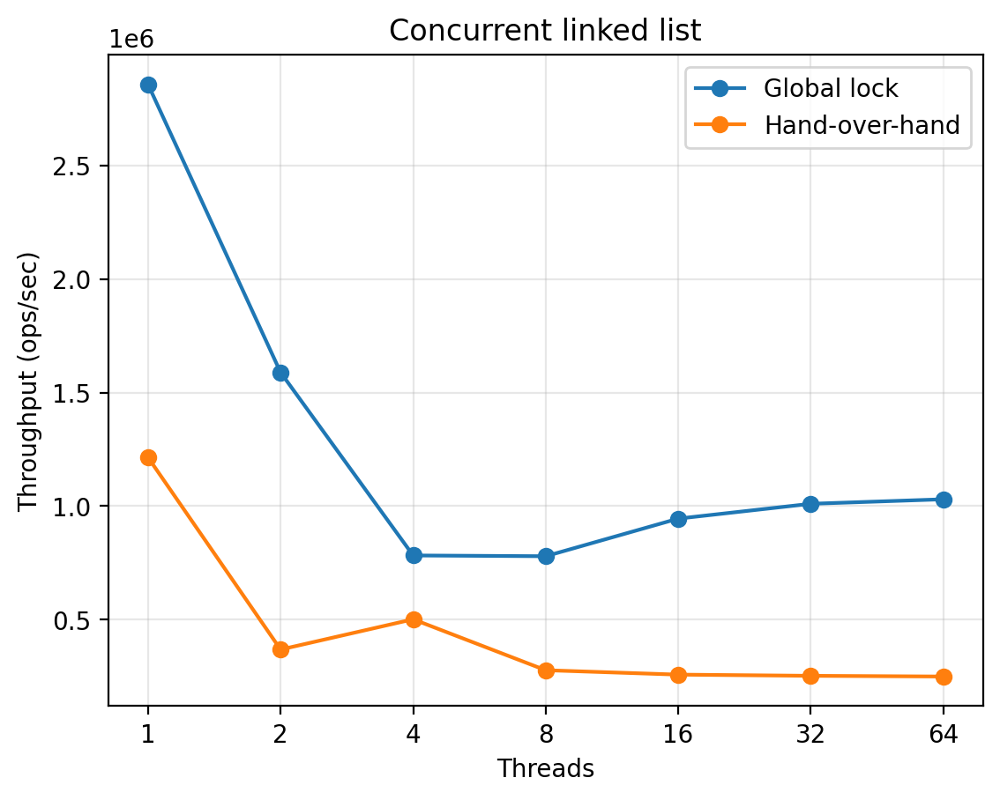

# Assignment 5

**(a) What was your initial conjecture on whether one will perform better than the other or both will perform the same?**

Ans. My initial conjecture is that since a hand over hand lock based list involves more locking and unlocking, there will be additional overheads. This will negatively impact throughput (ops/sec). But, the added benefit of parallelism i.e. more threads running simultaneously as opposed to global lock based list where one operation runs at a time might compensate for that overhead.

**(b) What is your final conclusion after you see the plots?**

Ans. The overhead did affect the throughput in hand-over-hand lock based list. But, parallelism did not compensate for it. The global lock list is faster at every thread count. And, neither list gained throughput from more threads. 

Global Lock List vs Hand-over-hand lock List:

- In a hand-over-hand lock based list, each operation passes through many nodes and locks and unlocks each one. The global lock list locks once per operation.
- Parallelism is limited. A thread cannot pass a slower thread ahead of it since every operation starts at the head.

Both througputs drop sharply with increasing threads because handing a lock from one core to another costs more than the compensation from extra threads.

**(c) How did you use LLM to complete the assignment?**

Ans. I generated the benchmarking script that gives a result.csv file at the end, and a small python file to make a matplotlib plot for the csv file. I also used it to understand additional reasonings behind the plot.

